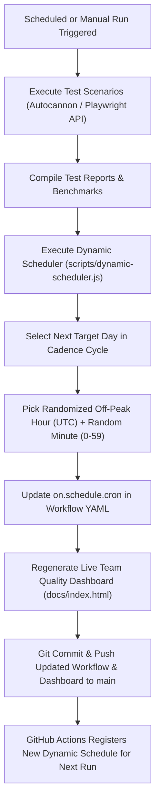

# 🕒 Dynamic Workflow Scheduling for Load & API Testing Suites

## 🎯 Executive Overview

To ensure that performance telemetry, rate-limit defenses, and API security checks reflect authentic production conditions, the **Load Testing Suite** and **API Risk-Tiered & Security Test Suites** implement **Dynamic Run-Time Rescheduling**.

Instead of executing at a static, predictable timestamp (which can suffer from CDN caching bias, coincide with scheduled cloud maintenance, or allow edge rate-limit counters to synchronize predictably), the schedule **dynamically shifts after every run** for the next run.

---

## 🏗️ Architecture & Mechanism



---

## ⚙️ Configuration & Variance Matrices

### 1. Load Testing Suite ([`.github/workflows/load-testing.yml`](.github/workflows/load-testing.yml))
* **Cadence Cycle**: Target Days `[0, 4]` (Sunday, Thursday UTC / Monday, Friday IST).
* **Allowed Off-Peak Hours (UTC)**: `[20, 21, 22, 23, 0, 1, 2, 3]` (01:30 AM – 08:30 AM IST).
* **Minute Variance**: Dynamic random integer between `0` and `59`.
* **Sample Dynamic Schedule**:
  * Run #1: `- cron: '11 21 * * 0'` (Sunday at 21:11 UTC / Monday at 02:41 IST)
  * Run #2: `- cron: '47 22 * * 4'` (Thursday at 22:47 UTC / Friday at 04:17 IST)
  * Run #3: `- cron: '28 20 * * 0'` (Sunday at 20:28 UTC / Monday at 01:58 IST)

### 2. API Test Suite Matrix ([`.github/workflows/test-api.yml`](.github/workflows/test-api.yml))
* **Cadence Cycle**: Target Days `[3, 6]` (Wednesday, Saturday UTC / Thursday, Sunday IST).
* **Allowed Off-Peak Hours (UTC)**: `[19, 20, 21, 22, 23, 0, 1, 2]` (00:30 AM – 07:30 AM IST).
* **Minute Variance**: Dynamic random integer between `0` and `59`.
* **Sample Dynamic Schedule**:
  * Run #1: `- cron: '4 21 * * 6'` (Saturday at 21:04 UTC / Sunday at 02:34 IST)
  * Run #2: `- cron: '39 19 * * 3'` (Wednesday at 19:39 UTC / Thursday at 01:09 IST)
  * Run #3: `- cron: '52 22 * * 6'` (Saturday at 22:52 UTC / Sunday at 04:22 IST)

---

## 🔐 GitHub Actions Token & Permissions

Modifying workflow files (`.github/workflows/*.yml`) within a running GitHub Actions workflow is protected by GitHub's OAuth security rules:

1. **Workflow Permissions**: Both workflows declare:
   ```yaml
   permissions:
     contents: write
     actions: write
   ```
2. **Personal Access Token (PAT) for Workflow Updates**:
   To allow GitHub Actions to push changes to `.github/workflows/`, provide a secret named `WORKFLOW_UPDATE_TOKEN` or `GH_PAT` with the `workflow` scope.
3. **Graceful Fallback**:
   If `WORKFLOW_UPDATE_TOKEN` is not configured, the runner catches the git rejection, resets only the workflow file changes, commits and publishes the test reports and dashboard without failing the job, and outputs a helpful notice in the GitHub Actions summary.

---

## 💻 CLI Commands

The dynamic scheduling engine can be tested or triggered locally at any time:

```bash
# Run the dynamic scheduler test suite
npm run test:schedule

# Reschedule Load Testing Suite
npm run schedule:load

# Reschedule API Testing Suite
npm run schedule:api

# Dry run preview (does not modify files on disk)
node scripts/dynamic-scheduler.js --workflow=load-testing --dry-run
node scripts/dynamic-scheduler.js --workflow=test-api --dry-run

# Custom window override (e.g., custom hours 1-4 UTC, exact-date mode)
node scripts/dynamic-scheduler.js --workflow=load-testing --hours=1-4 --mode=dom
```

---

## 📊 Live Dashboard Integration

Dynamic schedule state is recorded in `test-reports/dynamic-schedule-state.json`. When `npm run generate:dashboard` compiles the live team quality dashboard ([`docs/index.html`](docs/index.html)), dynamic schedule badges appear in the **Load Testing Suite** and **API Test Suite Matrix** views, showing the exact upcoming scheduled run in local IST and UTC.

